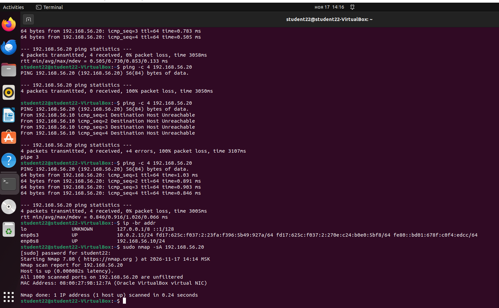
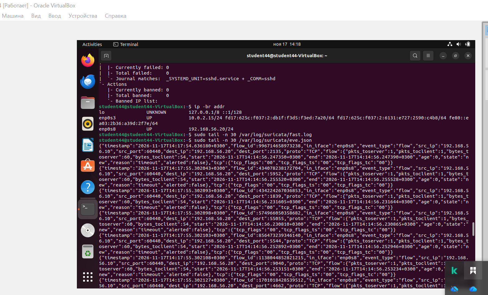
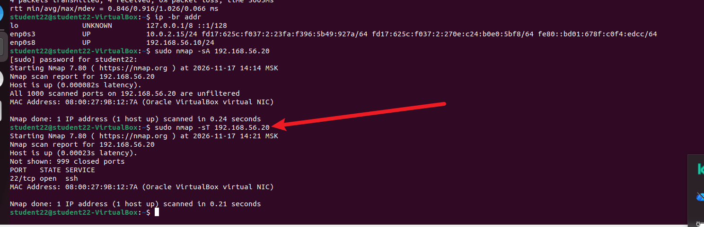
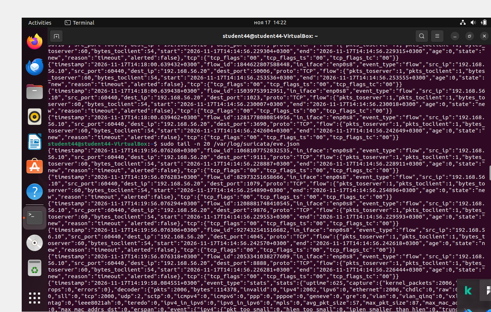

# Домашнее задание к занятию "`Защита сети`" - `Olga Dunaevskaya`

### Задание 1

Сканирование sudo nmap -sA:   

Лог Сурикаты:  

Сканирование sudo nmap -sT:   

Лог Сурикаты:  

Сканирование sudo nmap -sS:   
Лог Сурикаты:  

Сканирование sudo nmap -sV:   
Лог Сурикаты:  
 
   
### Задание 2

1. [Руководство по оформлению Markdown файлов](https://gist.github.com/Jekins/2bf2d0638163f1294637#Code)

2. 1. [Руководство по оформлению Markdown файлов](https://gist.github.com/Jekins/2bf2d0638163f1294637#Code)
  
1. [Руководство по оформлению Markdown файлов](https://gist.github.com/Jekins/2bf2d0638163f1294637#Code)      
