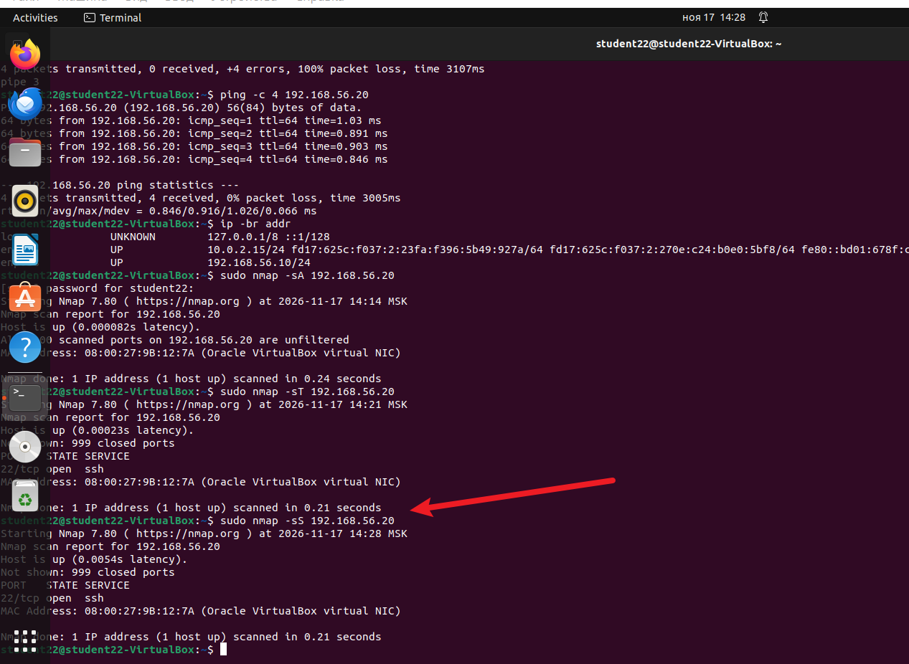
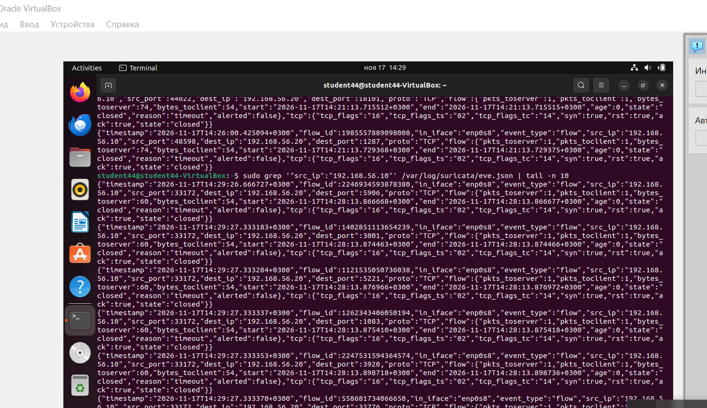
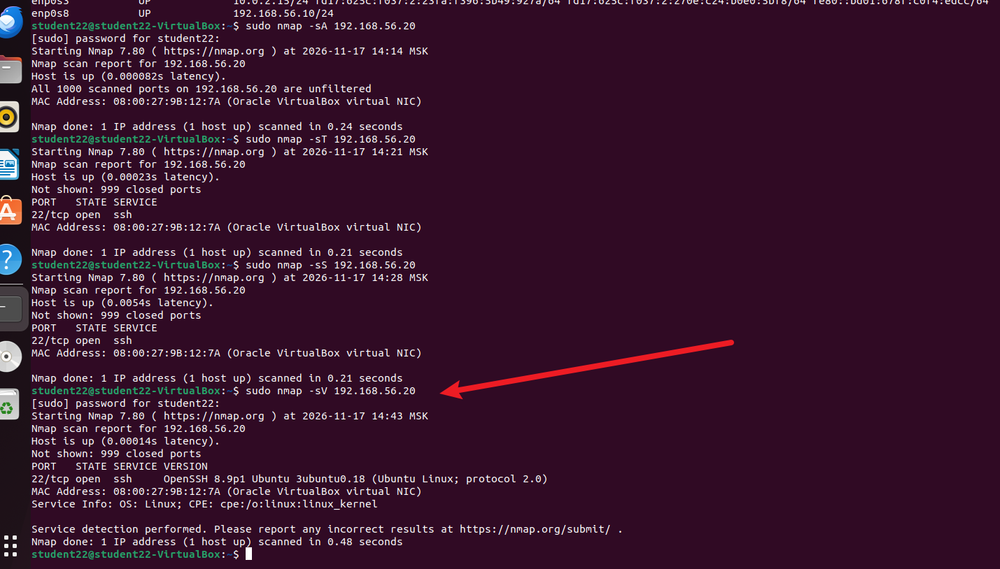
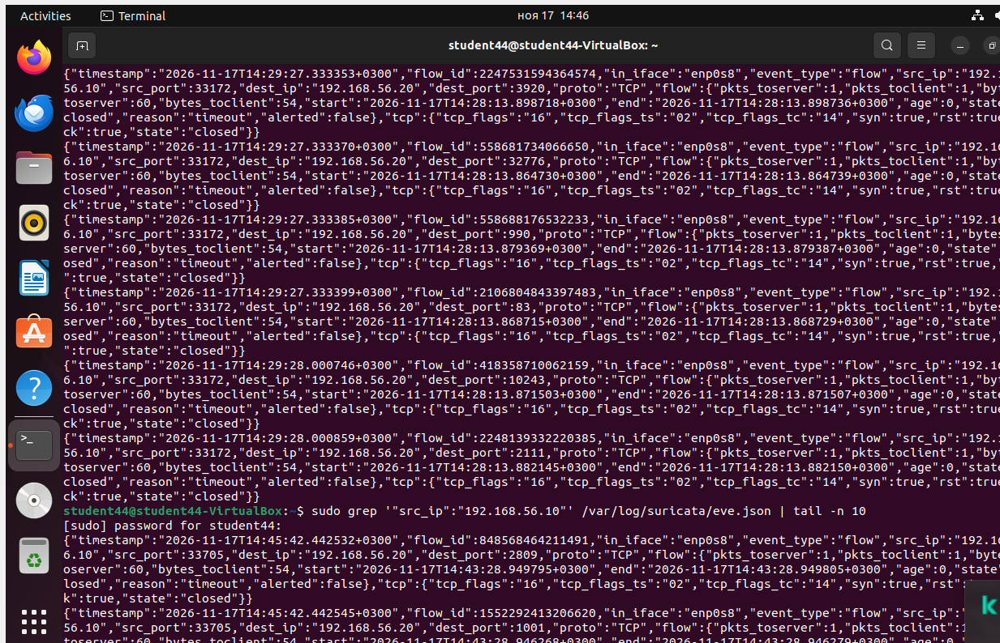
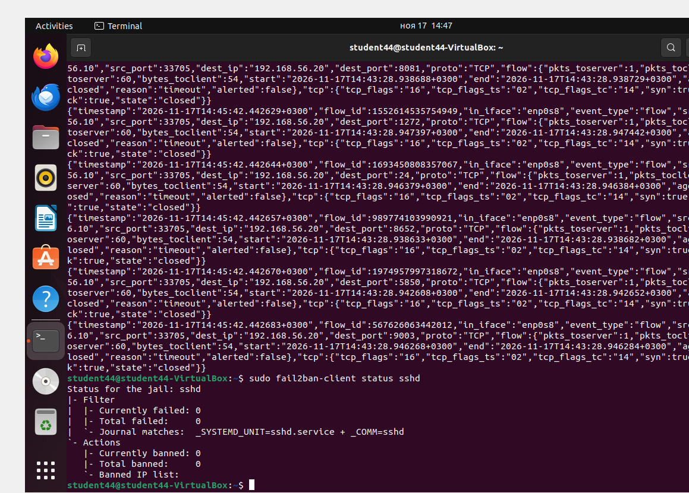
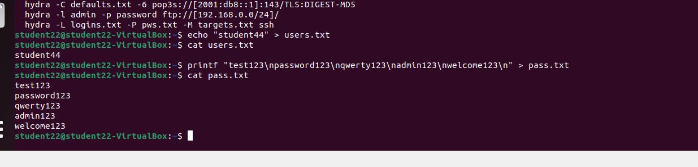
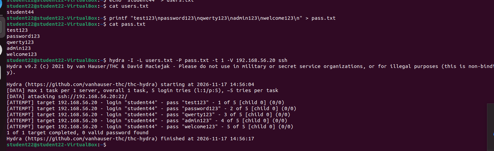
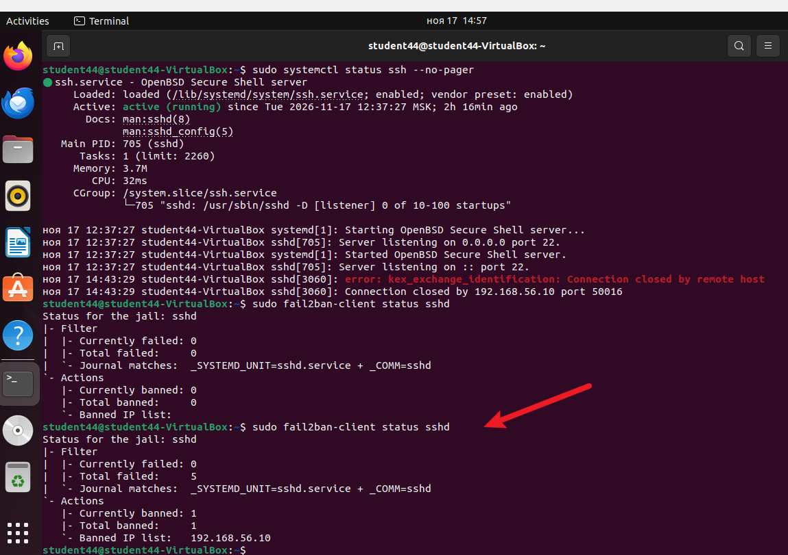
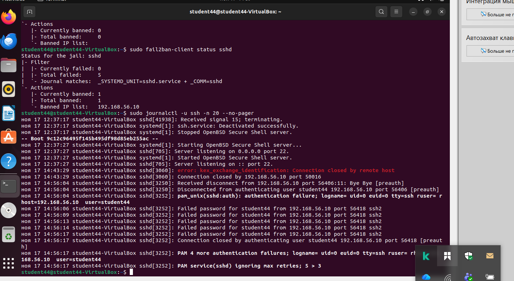
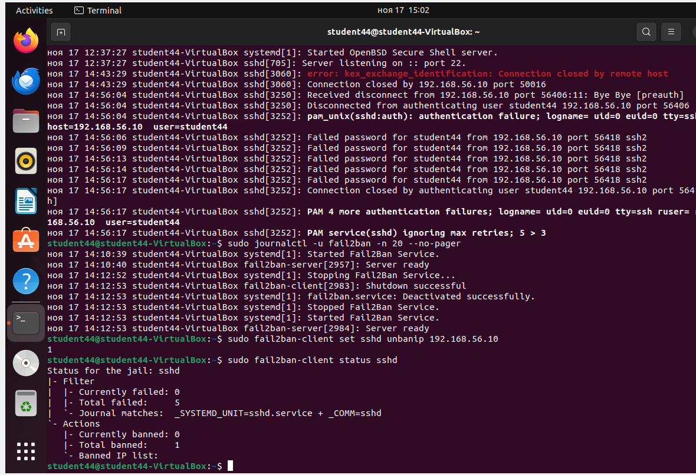

# Домашнее задание к занятию "`Защита сети`" - `Olga Dunaevskaya`

### Задание 1

Сканирование sudo nmap -sA:   

Лог Сурикаты:  

Сканирование sudo nmap -sT:   

Лог Сурикаты:  

Сканирование sudo nmap -sS:   

Лог Сурикаты:  

Сканирование sudo nmap -sV:   

Лог Сурикаты:  
 
 Fail2ban: 
 

### Выводы по заданию 1: 
Suricata видит сканирование Nmap. Она записала его в eve.json, а не в fast.log.
Важные поля из  журнала:
"in_iface":"enp0s8",
"event_type":"flow",
"src_ip":"192.168.56.10",
"dest_ip":"192.168.56.20",
"proto":"TCP"
Что это означает:
•	event_type: flow — Suricata зарегистрировала сетевой поток.
•	alerted: false — правило обнаружения не сработало, поэтому тревожное событие не сформировано.
То есть трафик зафиксирован. 
Сканирование -sT прошло, Suricata видит обращения с атакующей машины и записывает их в eve.json. Отсутствие тревог в fast.log не означает, что сканирование не обнаружено на уровне сетевых событий.
Третий вид сканирования:
•	src_ip: 192.168.56.10 — атакующая машина.
•	dest_ip: 192.168.56.20 — защищённая машина.
•	tcp_flags_ts: 02 — SYN-пакет от сканирующей машины.
•	tcp_flags_tc: 14 — ответ RST/ACK от защищённой машины для закрытых портов.
•	state: closed — TCP-соединение закрыто.
•	alerted: false — отдельная тревога не сформирована.
Suricata регистрирует сетевые события SYN-сканирования, но текущие правила не создают отдельные предупреждения о сканировании.
Четвертое скаинрование:
•	22/tcp open — открыт TCP-порт 22.
•	SERVICE: ssh — на порту работает SSH.
•	VERSION: OpenSSH 8.9p1 Ubuntu 3ubuntu0.18 — обнаружена версия SSH-сервера.
•	OS: Linux — Nmap определил операционную систему как Linux.
•	999 closed ports — остальные проверенные порты закрыты.
Сканирование -sV позволило определить не только открытый порт, но и конкретную службу с её версией. Это полезно для инвентаризации сервисов и оценки потенциальных уязвимостей.
Не проверяли Fail2Ban после первых четырёх сканирований Nmap, потому что Suricata и Fail2Ban выполняют разные задачи и реагируют на разные типы событий.Suricata, которая анализирует именно сетевой трафик. Fail2Ban не предназначен для обнаружения самого факта сканирования портов.

   
### Задание 2

Подготовка к заданию 2:   

Запуск Гидры (атака):  

Fail2ban после атаки:   

Логи после атки:  

Снятие блокировки:   

Fail2Ban отслеживал SSH-аутентификацию: его задача — обнаружить пять неудачных попыток входа за десять минут, что собственно было сделано.
 
